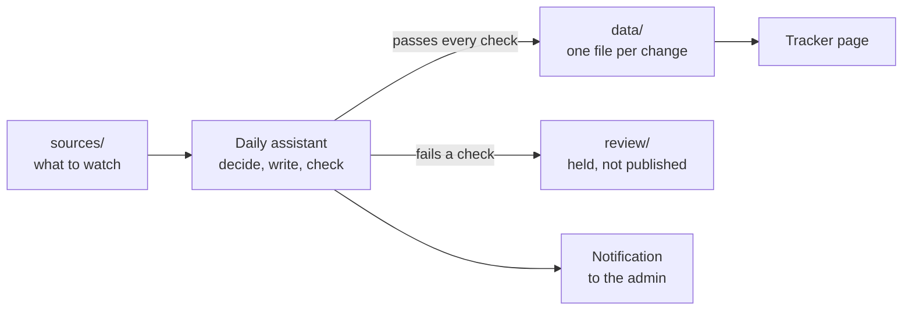

# Regulation tracker

A public page where law firms see what has changed in legal regulation, for one country at a time (UK or Australia). An AI assistant keeps it current every morning. Nobody needs to touch it day to day.

## How it works



The repo is the database. Every change to it is a dated commit that can be undone.

| Folder | What it holds |
|---|---|
| `sources/` | The official pages and feeds the assistant watches, per country. Each one can be switched on or off. |
| `data/<country>/` | One file per regulatory change. |
| `data/seen.json` | Every page the assistant has already read, and what it decided. |
| `data/log/` | What each run did, including what it ignored and why. |
| `review/` | Items the assistant drafted but did not publish, with the reason. |
| `agent/` | The assistant: its rules, its limits and its code. |
| `mockup/` | The page design. |

## What the assistant does each morning

1. **Read the sources.** It lists what each source shows and skips every page it has seen before.
2. **Decide.** For each new page, the AI reads it alongside every change already held and picks one of three:
   - **new:** a change the tracker does not hold;
   - **update:** a fact changed on a change it already holds (stage, a date, who it applies to, or what the rule requires);
   - **ignore:** anything else, such as reminders, appointments and fines against individuals.
3. **Check in code.** Hard rules the AI cannot talk its way past:
   - every text field has a length limit;
   - dates are real, and nothing is "in force" before its start date;
   - a stage never moves backwards;
   - a new change is rejected if it shares an id, a source page or a near-identical title with an existing one.
4. **Check with a second reader.** A separate AI pass, which never saw the first one's reasoning, compares the record with the source. It fails anything unsupported, wrongly dated or duplicated.
5. **Publish or hold.** A record that passes everything is saved as its own commit. Anything else goes to `review/` and is not published.
6. **Notify.** The run opens a GitHub issue listing every new change, every update, and everything held. GitHub emails it to people watching the repo.

Two things happen without the AI:

- A decided change moves to "in force" on the morning its exact start date arrives.
- On Mondays, the assistant re-reads the source page of every change that is still proposed or decided.

## How repeats and bloat are prevented

- **One change, one record, for its whole life.** A consultation, its decision and its start date are the same record.
- **An update rewrites; it never appends.** The record always describes the change as it stands today, inside the same length limits as a new one. What happened along the way goes in `history`, one short line per event.
- **Rewording is not an update.** If no fact changed, nothing is saved.
- **Admin decisions stick.** An archived change is never re-added, and a reverted update is never re-applied, even when a different source reports it.

The length limits are in `agent/config.json`:

| Field | Limit |
|---|---|
| Title | 80 characters |
| Summary | 240 characters |
| What changes | 4 points, 150 characters each |
| Who it applies to | 180 characters |
| History line | 120 characters |

## Admin actions

Run the **Admin action** workflow in GitHub (Actions tab), or the same command locally.

| Command | What it does |
|---|---|
| `revert <id>` | Undoes the last change made to that record. The assistant is told not to apply it again. |
| `archive <id>` | Hides the change from the page. The assistant will not re-add it. |
| `restore <id>` | Shows an archived change again. |

Each takes an optional reason, which the assistant reads on later runs.

## Running it

```bash
node --test "agent/test/*.test.mjs"   # the code checks; no AI, a few seconds
node agent/test/scenario.mjs           # a full trial on made-up pages; uses the real AI
node agent/run.mjs                     # a real run; add --commit to save each change as a commit
```

Useful options for `run.mjs`:

- `--since 2026-10-01`: how far back to look. The default is 60 days.
- `--source sra-news`: check one source only.
- `--recheck`: also re-read the sources of changes that are still moving.

## To switch it on

1. Merge this branch into `main`. GitHub only runs schedules from the main branch.
2. Add one secret to the repo (Settings, Secrets and variables, Actions):
   - `ANTHROPIC_API_KEY`, a dedicated API key; or
   - `CLAUDE_CODE_OAUTH_TOKEN`, made by running `claude setup-token`, which uses that person's Claude subscription.
3. Run **Daily check** once by hand from the Actions tab and read the notification it opens.

The source addresses in `sources/` have not been tested against the live sites yet. The first run reports any that fail.
