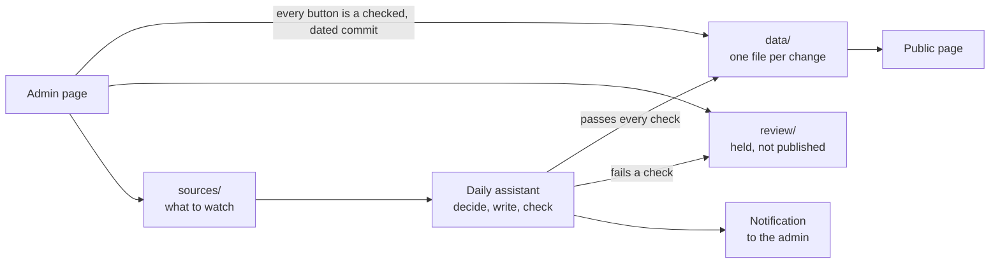

# Regulation tracker

A public page where law firms see what has changed in legal regulation, for one country at a time (UK or Australia). An AI assistant keeps it current every morning. Nobody needs to touch it day to day; an admin page is there for the times someone wants to.

## How it works



The repo is the database. Every change to it is a dated commit that can be undone.

| Folder | What it holds |
|---|---|
| `sources/` | The official pages and feeds the assistant watches, per country. Each one can be switched on or off. |
| `data/<country>/` | One file per regulatory change. |
| `data/seen.json` | Every page the assistant has already read, and what it decided. |
| `data/log/` | What each run did, including what it ignored and why. |
| `review/` | Items the assistant drafted but did not publish, with the reason. |
| `agent/` | The assistant: its rules, its limits and its code. |
| `web/` | The two pages: the public tracker (`index.html`) and the admin page (`admin.html`, `admin.js`). Their built versions go to the `published` branch. |

## What the assistant does each morning

1. **Read the sources.** It lists what each source shows and skips every page it has read, unless the listing shows the page has been updated since.
2. **Decide.** For each new page, the AI reads it alongside every change already held and picks one of three:
   - **new:** a change the tracker does not hold;
   - **update:** a fact changed on a change it already holds (stage, a date, who it applies to, or what the rule requires);
   - **ignore:** anything else, such as reminders, appointments and fines against individuals.
3. **Check in code.** Hard rules the AI cannot talk its way past:
   - every text field has a length limit;
   - dates are real, and nothing is "in force" before its start date;
   - a stage never moves backwards;
   - a new change is rejected if it shares an id, a source page or a near-identical title with an existing one.
4. **Check with a second reader.** A separate AI pass, which never saw the first one's reasoning, compares the record with the source. It fails anything unsupported, wrongly dated or duplicated.
5. **Publish or hold.** A record that passes everything is saved as its own commit. Anything else goes to `review/` and waits for the admin.
6. **Notify.** The run opens a GitHub issue listing every new change, every update, everything held and every problem. GitHub emails it to people watching the repo.

Three things happen without the AI:

- A decided change moves to "in force" on its exact start date, after that day's sources have been read.
- On Mondays, the assistant re-reads the source page of every change that is still proposed or decided.
- A page that cannot be read is tried on three runs and then set aside, so one broken link does not nag forever.

## How repeats and bloat are prevented

- **One change, one record, for its whole life.** A consultation, its decision and its start date are the same record.
- **An update rewrites; it never appends.** The record always describes the change as it stands today, inside the same length limits as a new one. What happened along the way goes in `history`, one short line per event.
- **Rewording is not an update.** If no fact changed, nothing is saved.
- **Admin decisions stick.** An archived change is never re-added, and a reverted or dismissed update is never re-applied, even when a different source reports it.

The length limits are in `agent/config.json`:

| Field | Limit |
|---|---|
| Title | 80 characters |
| Summary | 240 characters |
| What changes | 4 points, 150 characters each |
| Who it applies to | 180 characters |
| History line | 120 characters |

## The admin page

The admin page reads the repository directly, so it always shows the current state. It has three tabs:

- **Activity:** what each check published, updated, ignored or could not read. Held items wait here for a decision.
- **Changes:** every change, on the page or archived. Edit, archive or restore any of them.
- **Sources:** what the assistant watches. Switch a source on or off, add one, or start the run of the past.

Every button runs the **Admin action** workflow once. The same code checks an admin's edit as checks the assistant's work, so an over-long title is refused either way.

| Action | What it does |
|---|---|
| Review, then Publish | Publishes a held item, with any edits made in the form. |
| Dismiss | Throws a held item away. A dismissed update is not tried again. |
| Edit | Changes a change's text, stage or dates. The assistant keeps the admin's wording unless a fact changes. |
| Undo update | Puts back the version before the assistant's last update, and tells it not to apply that update again. |
| Archive / Restore | Takes a change off the page, or puts it back. An archived change is never re-added. |
| Add anyway | Asks the assistant to add a page it ignored. Every other check still applies. |
| Source on / off / add | Changes what is watched. A new address is tested before it is saved. |
| Load older changes | Starts the run of the past (below). |

To use the buttons, an admin connects once per browser with a GitHub token that can run actions on this repository. The page explains how. The token stays in that browser.

## The run of the past

A normal check looks back 60 days and reads the first page of each listing. The run of the past looks back to a date you choose and reads older listing pages too.

Start it from the admin page (Sources, "Load older changes"), or run **Daily check** by hand with a date in "since". It reads oldest first, saves as it goes, stops itself after five hours and starts again until it is done. Expect several hours and one AI call or two for every page it reads.

## Running it

```bash
node --test "agent/test/*.test.mjs"   # every check, and rehearsals of whole runs; no AI, a few seconds
node agent/test/scenario.mjs           # a full trial on made-up pages; uses the real AI
node agent/check-sources.mjs           # read every source and report what it lists; no AI
node agent/run.mjs                     # a real run; add --commit to save each change as a commit
node agent/build-page.mjs              # build the pages and the data feed into site/
```

Useful options for `run.mjs`:

- `--since 2026-01-01`: how far back to look. The default is 60 days.
- `--pages 15`: also read this many older listing pages per source.
- `--source sra-news`: check one source only.
- `--recheck`: also re-read the sources of changes that are still moving.
- `--include <address>`: add one page the assistant had ignored.

## Sources today

| Country | Switched on | Notes |
|---|---|---|
| UK | SRA news and consultations, Legal Services Board, HM Treasury, OFSI, Companies House, new legislation | All read cleanly from GitHub. |
| Australia | Legal Services Council, VLSB+C, Legal Practice Board of WA, Queensland Law Society, Attorney-General's consultations | All read cleanly from GitHub. |
| Australia | AUSTRAC, OAIC | Switched off. Both refuse automated readers. GitHub's network gets no answer, and Claude's web fetch returns only stored copies that are weeks old, so neither can be trusted for a daily check. Reading them needs the regulator's permission or feed, or a reader running on a network they accept. |

## Where the tracker shows up

Nothing is hosted from this repository. After every daily check and admin action, the **Publish the feed** workflow puts the latest build on the `published` branch:

| File | For |
|---|---|
| `tracker.json` | The Legl website. It holds every live change and the labels to show them with. |
| `index.html` | The same data as a finished, self-contained page, if a ready-made page is wanted. |
| `admin.html` | The admin page. An admin downloads it once and opens it on their own computer. |

**On legl.com:** the website reads `https://raw.githubusercontent.com/<owner>/<repo>/published/tracker.json` and shows it in its own design. The tracker then updates every morning with no change to the website.

**The admin page:** download `admin.html` from the `published` branch and open it in a browser. It is not on any website, so there is nothing public to find. Download it again after the admin page itself changes.

## To switch it on

Everything is built and tested. Two things are left.

1. **The AI key.** A repository admin adds the Actions secret `ANTHROPIC_API_KEY`. Use a key made for this alone, in its own workspace, with a monthly spend limit. It pays for the daily check.
2. **Admins.** Anyone with write access can run admin actions, so give write access only to the admins. Each admin connects the admin page with their own fine-grained token for this one repository (Actions: read and write; Contents: read-only), and watches the repository to get the daily update by email.

**What is kept where:**

- The AI key exists only as the repository secret. It is passed only to the two steps that call the AI, and never to a web page being read.
- An admin's token stays in that admin's browser. The admin page can talk only to GitHub and runs only its own script.
- The tracker holds public regulator pages and what was written from them. It holds no customer data.

After that the check runs every morning at 06:17 UTC. To fill in history, start the run of the past once from the admin page.
